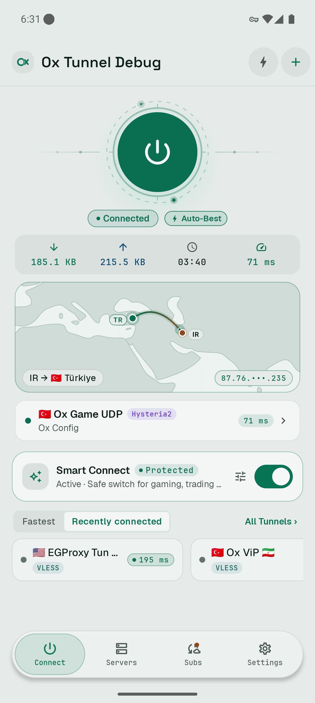
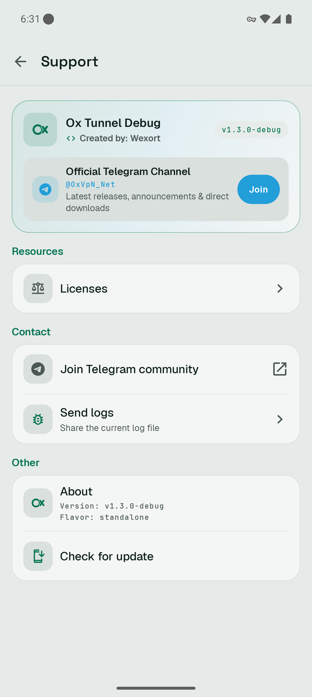

# Ox Tunnel

**Multi-Protocol WireGuard + Xray VPN Client for Android**

[**Download Latest Release (GitHub)**](https://github.com/MasterALiReza/OxTunnel/releases/latest) · [**Telegram Channel (@OxVpN_Net)**](https://t.me/OxVpN_Net)

[فارسی](#فارسی) · [English](#english)

 

   

---

## English

**Ox Tunnel** is a fast, modern, battery-conscious Android VPN client created by **Wexort** that brings **WireGuard / AmneziaWG** and **Xray** protocols (`VLESS`, `VMess`, `Trojan`, `Shadowsocks`, `Hysteria2`) together under one clean, unified interface.

### Key Features

- **Multi-Protocol Engine:** WireGuard, AmneziaWG, VLESS (TLS / Reality), VMess, Trojan, Shadowsocks, and Hysteria2 in one app.
- **Smart Connect Failover:** Automatically monitors active connections and switches to the lowest-ping healthy server within the same subscription — or cross-protocol (`Xray ↔ WireGuard`) if all servers go down — using a configurable grace window (**10s Standard** / **15s Gaming & Trading**) so brief 2–3s spikes never disrupt matches, trades, or calls.
- **Interactive World Route Map:** Smooth vector world map with dynamic regional zoom, live route animation, and real exit country & masked IP detection across both WireGuard and Xray.
- **Unified Connection Modes & Split Tunneling:** Switch between **VPN**, **Local Proxy** (SOCKS5 / HTTP without VPN interface), and **Lockdown (Kill Switch)** modes, with live-applying global **App Split Tunneling** (Include / Bypass) and encrypted **DNS** (`DoH` / `DoT`).
- **Smart Subscriptions & Sharing:** Auto-sync subscription links with clear data quota and expiration indicators, health alerts when plans expire or run out, plus one-tap **QR code & link sharing**.
- **Auto-Best & Per-Server Quick Connect:** Real delay benchmarking (`generate_204`) to rank and connect to the fastest server, plus individual Connect/Disconnect buttons right on each server card.
- **Direct In-App Updates:** Automatic GitHub release checks with full changelog preview, direct in-app APK download & install, plus an optional **Telegram Channel (`@OxVpN_Net`)** download option.
- **Low-End & Battery Friendly:** Hardware-accelerated sliding dock animations, cached vector map paths, automatic pausing of off-screen/idle animations, and zero-polling idle Smart Connect.
- **Bilingual & Themed:** Full **Persian (RTL)** and **English** support with **Obsidian Dark** and **Business Light** themes.

### Download

Download directly from [GitHub Releases](https://github.com/MasterALiReza/OxTunnel/releases/latest) or grab official APK builds from our [Telegram Channel (@OxVpN_Net)](https://t.me/OxVpN_Net):

| File | Recommended For |
|---|---|
| `oxtunnel-standalone-v*-arm64.apk` | Most modern 64-bit Android phones (**recommended**) |
| `oxtunnel-standalone-v*-armv7.apk` | Older 32-bit Android phones |
| `oxtunnel-standalone-v*.apk` | Universal build supporting both ABIs (larger size) |

- Requires **Android 8.0 (API 26)** or newer.
- Every release includes `SHA256SUMS.txt` so you can verify download integrity.

### Screenshots

| Connect (Dark) | Servers (Dark) | Connect (Light) |
|---|---|---|
|  |  |  |

| Subscriptions | Settings | Support & About |
|---|---|---|
|  |  |  |

### Community & Support

- **Official Telegram Channel & Releases:** [@OxVpN_Net](https://t.me/OxVpN_Net) — announcements, new versions, and alternative direct APK downloads.
- **Releases & Changelogs:** [GitHub Releases](https://github.com/MasterALiReza/OxTunnel/releases)
- **Bug Reports & Feature Requests:** [GitHub Issues](https://github.com/MasterALiReza/OxTunnel/issues)
- **Author & Maintainer:** **Wexort**

### License & Credits

The source code of Ox Tunnel is private; this repository hosts official signed release binaries and documentation. Ox Tunnel builds upon open-source components — see [NOTICE.md](NOTICE.md) and `licenses/` for full attributions.

---

## فارسی

**Ox Tunnel** یک اپلیکیشن مدرن، سریع و بهینه VPN برای اندروید (ساخت **Wexort**) است که پروتکل‌های **WireGuard / AmneziaWG** و **Xray** (`VLESS`، `VMess`، `Trojan`، `Shadowsocks` و `Hysteria2`) را به‌صورت کاملاً یکپارچه در یک برنامه ارائه می‌دهد.

### امکانات کلیدی

- **پشتیبانی چندپروتکلی کامل:** وایرگارد، AmneziaWG، VLESS (با TLS و Reality)، VMess، Trojan، Shadowsocks و Hysteria2 در یک اپلیکیشن واحد.
- **اتصال هوشمند (Smart Connect):** پایش خودکار اتصال فعال و جابجایی هوشمند به کم‌پینگ‌ترین سرور سالم هم‌اشتراک — یا تغییر خودکار پروتکل (`Xray ↔ WireGuard`) در صورت قطعی کل سرورها — با بازه صبر قابل‌تنظیم (**۱۰ ثانیه استاندارد** / **۱۵ ثانیه گیم و ترید**) تا نوسان‌های ۲ تا ۳ ثانیه‌ای باعث قطع شدن بازی، معامله یا تماس نشود.
- **نقشه تعاملی مسیر جهانی:** نقشه برداری دقیق با زوم هوشمند منطقه‌ای، انیمیشن مسیر اتصال و نمایش کشور و IP واقعی خروج در هر دو موتور WireGuard و Xray.
- **حالت‌های یکپارچه اتصال و Split Tunneling:** انتخاب مستقیم بین **VPN**، **پراکسی محلی (Local Proxy)** و **قفل شبکه (Lockdown / Kill Switch)** همراه با **App Split Tunneling** سراسری (اعمال زنده روی WireGuard و Xray) و تنظیمات **DNS رمزنگاری‌شده (`DoH` / `DoT`)**.
- **مدیریت حرفه‌ای اشتراک‌ها (Subs):** همگام‌سازی خودکار لینک‌های سابسکریپشن، نمایش دقیق حجم و روزهای باقی‌مانده، هشدار شفاف هنگام اتمام حجم یا تاریخ، و اشتراک‌گذاری سریع لینک و **کد QR**.
- **Auto-Best و اتصال سریع هر سرور:** تست واقعی تأخیر سرورها برای انتخاب سریع‌ترین گزینه و دکمه اتصال/قطع مستقیم روی تک‌تک کارت‌های سرور.
- **به‌روزرسانی مستقیم درون‌برنامه‌ای:** بررسی خودکار نسخه‌های جدید گیت‌هاب با نمایش لیست تغییرات، دانلود و نصب مستقیم درون اپ، و گزینه همیشگی دانلود از **کانال تلگرام (`@OxVpN_Net`)**.
- **بهینه برای گوشی‌های ضعیف و کم‌مصرف در باطری:** انیمیشن لغزنده و سخت‌افزاری داک پایین، کش مسیرهای نقشه، توقف خودکار انیمیشن‌ها در پس‌زمینه و مصرف صفر Smart Connect در حالت قطع.
- **پشتیبانی کامل از فارسی (راست‌به‌چپ) و انگلیسی** در کنار دو تم **Obsidian Dark (تاریک)** و **Business Light (روشن)**.

### دانلود نسخه رسمی

از صفحه [Releases در گیت‌هاب](https://github.com/MasterALiReza/OxTunnel/releases/latest) یا از طریق [کانال رسمی تلگرام (@OxVpN_Net)](https://t.me/OxVpN_Net) فایل مناسب گوشی خود را دانلود کنید:

| فایل | مناسب برای |
|---|---|
| `oxtunnel-standalone-v*-arm64.apk` | بیشتر گوشی‌های ۶۴ بیتی اندروید (**پیشنهادی**) |
| `oxtunnel-standalone-v*-armv7.apk` | گوشی‌های قدیمی‌تر ۳۲ بیتی |
| `oxtunnel-standalone-v*.apk` | نسخه همگانی (سازگار با هر دو معماری، حجم بیشتر) |

- حداقل نیازمندی: **اندروید ۸٫۰** یا بالاتر.
- فایل `SHA256SUMS.txt` در کنار هر نسخه برای بررسی اصالت و سلامت فایل نصبی قرار داده شده است.

### کانال تلگرام، کامیونتی و پشتیبانی

- **کانال رسمی تلگرام و انتشار نسخه‌ها:** [@OxVpN_Net](https://t.me/OxVpN_Net) — اطلاع‌رسانی آپدیت‌ها، تغییرات و دانلود مستقیم نسخه‌های جدید.
- **نسخه‌های رسمی در گیت‌هاب:** [GitHub Releases](https://github.com/MasterALiReza/OxTunnel/releases)
- **گزارش خطا و پیشنهادها:** [GitHub Issues](https://github.com/MasterALiReza/OxTunnel/issues)
- **سازنده و توسعه‌دهنده:** **Wexort**

### مجوز و قدردانی

سورس‌کد Ox Tunnel خصوصی است و این مخزن صرفاً برای انتشار فایل‌های نصبی رسمی و مستندات پروژه نگهداری می‌شود. Ox Tunnel بر پایه اجزای متن‌باز ساخته شده است؛ جزئیات مجوزها در [NOTICE.md](NOTICE.md) و پوشه `licenses/` قابل مشاهده است.

