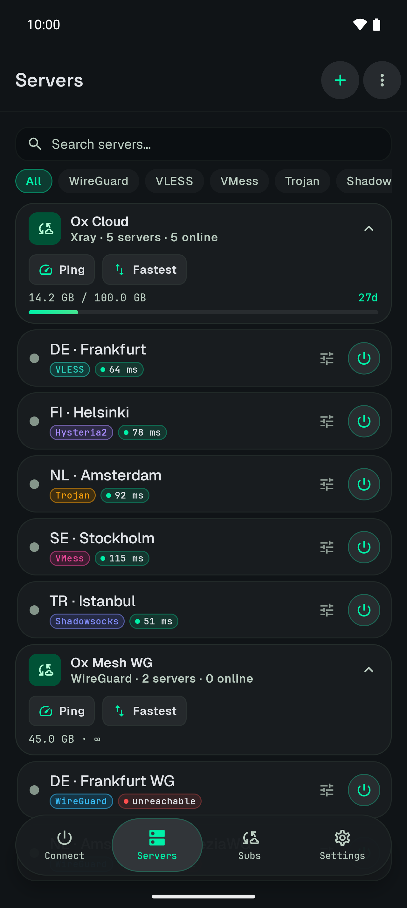
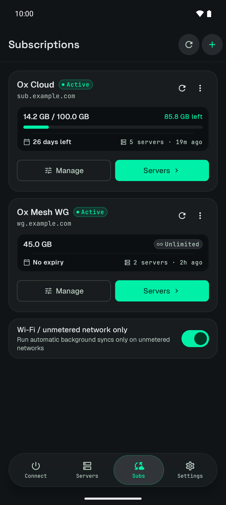
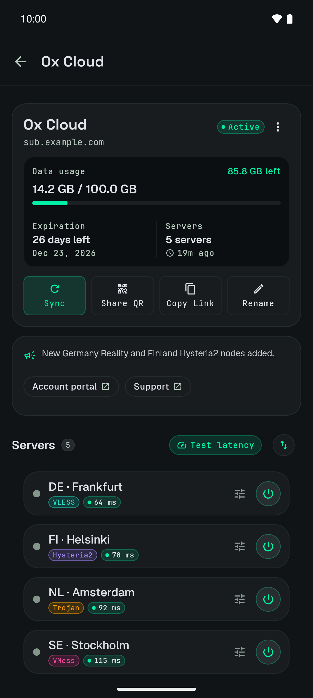
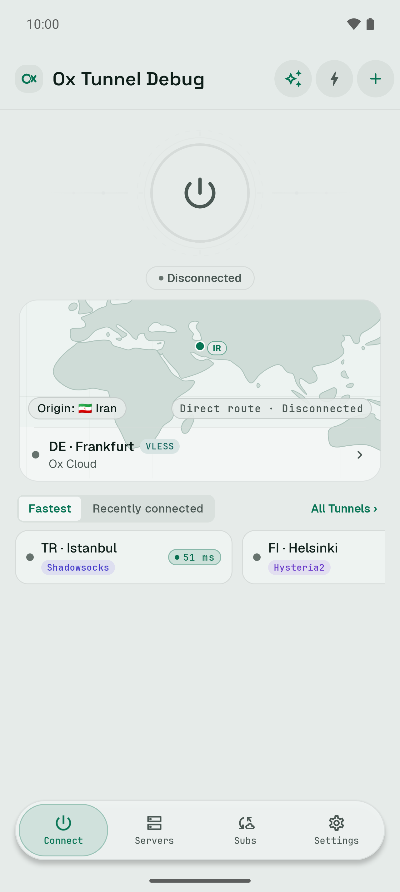
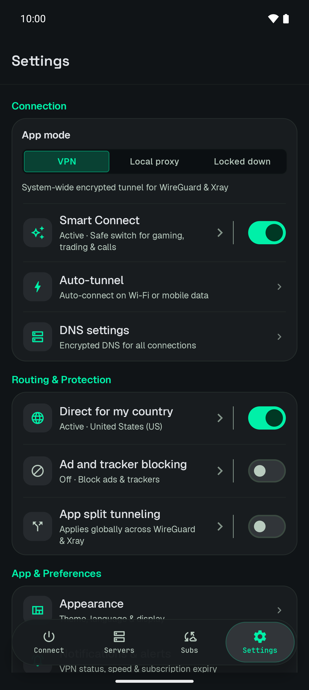
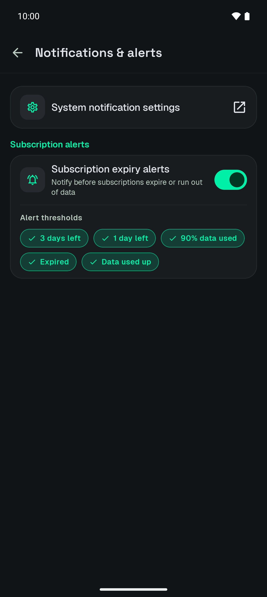

<div align="center">

# Ox Tunnel

VPN client for Android: WireGuard, AmneziaWG, and V2Ray/Xray configs in one place.

[**Download**](https://github.com/MasterALiReza/OxTunnel/releases/latest) · [Telegram](https://t.me/OxVpN_Net)

   

<details>
<summary>More screenshots</summary>
<br>
  
</details>

</div>

<div dir="rtl">

## فارسی

یک اپ ساده و کامل برای تمام کانفیگ‌هایتان: WireGuard، AmneziaWG، VLESS، VMess، Trojan، Shadowsocks و Hysteria2.

### امکانات اصلی

- **مدیریت اشتراک‌ها:** لینک سابسکریپشن را یک بار اضافه کنید تا سرورها خودکار به‌روز بمانند. حجم مصرفی، روزهای باقی‌مانده و هشدار نزدیک شدن به انقضا همیشه دم دست است. در صورت فیلتر بودن لینک ساب، می‌توانید به‌روزرسانی را از طریق خود VPN انجام دهید.
- **اتصال هوشمند و تست پینگ:** با یک لمس سریع‌ترین سرور را پیدا کنید. اگر اتصال هوشمند روشن باشد، در صورت قطعی واقعی، اپ بدون دست‌کاری افت‌های لحظه‌ای شما را به سرور سالم بعدی منتقل می‌کند.
- **مسیریابی و حریم خصوصی:** عبور مستقیم سایت‌های داخلی (GeoIP/GeoSite)، مسدودسازی تبلیغات و ردیاب‌ها، انتخاب برنامه‌هایی که از VPN رد شوند (Split Tunneling)، DNS رمزنگاری‌شده و حالت Kill Switch.
- **ابزارهای عبور از فیلترینگ (در بخش پیشرفته):** TLS Fragment، UDP Noise، Mux، زنجیره WARP و اسکنر IP تمیز کلادفلر.
- **کاربردی برای استفاده روزمره:** کاشی تنظیمات سریع (Quick Settings)، ویجت صفحه اصلی، آمار مصرف روزانه فقط روی دستگاه خودتان، آپدیت از داخل اپ، و پشتیبانی کامل از فارسی و انگلیسی در تم تیره و روشن.

### دانلود و نصب

از صفحهٔ [Releases](https://github.com/MasterALiReza/OxTunnel/releases/latest) نسخهٔ مناسب گوشی خود را بگیرید (حداقل اندروید ۸):

- `arm64`: برای تقریباً همهٔ گوشی‌های جدید.
- `armv7`: برای گوشی‌های قدیمی‌تر ۳۲ بیتی.
- فایل بدون پسوند: اگر مطمئن نیستید کدام را انتخاب کنید.

### افزودن اشتراک با یک کلیک از تلگرام

تلگرام در دکمه‌های ربات و پیام‌ها فقط پیوندهای `http(s)` و `tg` را قابل کلیک می‌کند. برای ساخت دکمه «افزودن به آکس تانل» از صفحهٔ پل HTTPS زیر استفاده کنید (توکن داخل `#` فقط روی دستگاه کاربر خوانده می‌شود و به سرور ارسال نمی‌شود):

```
https://masteralireza.github.io/OxTunnel/add#<url-encoded-https-subscription-url>
```

این صفحه اپ را با پیوند `oxtunnel://add?url=<url-encoded>` باز می‌کند و اگر اپ نصب نباشد، دکمه دانلود آخرین نسخه را نشان می‌دهد. آکس تانل پیش از ذخیره همیشه پنجره تأیید را به کاربر نمایش می‌دهد.

</div>

## English

One clean Android client for WireGuard, AmneziaWG, VLESS, VMess, Trojan, Shadowsocks, and Hysteria2.

### What it does

- **Subscriptions:** Add a subscription link once and keep servers synced automatically. Remaining data, expiry countdown, and low-data/expiry alerts stay visible. If a subscription host is blocked, you can sync it through the active VPN.
- **Smart Connect & latency:** Test real delay across servers and pick the fastest one in a tap. With Smart Connect enabled, the app moves you to a working server if the tunnel actually drops while ignoring brief 2–3s hiccups.
- **Routing & privacy:** Direct routing for domestic sites (GeoIP/GeoSite), ad and tracker blocking, per-app split tunneling, encrypted DNS, and a lockdown kill switch.
- **Censorship tools (Advanced):** TLS Fragment, UDP Noise, Mux, Cloudflare WARP chaining, and a built-in Clean Cloudflare IP scanner.
- **Everyday basics:** Quick Settings tile, home screen widgets, on-device daily traffic stats (nothing leaves your phone), in-app updates, and full English & Persian support with dark and light themes.

### Download

Grab an APK from [Releases](https://github.com/MasterALiReza/OxTunnel/releases/latest) (Android 8.0 or newer):

- `arm64` — most modern phones.
- `armv7` — older 32-bit devices.
- Universal (no arch suffix) — if you are not sure.

Questions and bug reports: [Telegram](https://t.me/OxVpN_Net) or [Issues](https://github.com/MasterALiReza/OxTunnel/issues).

### One-tap Telegram subscription bridge

Telegram inline buttons only support `http(s)://` and `tg://` links. Providers and bots can link users directly through the privacy-preserving GitHub Pages bridge (the URL in `#` stays client-side and is never sent to GitHub):

```
https://masteralireza.github.io/OxTunnel/add#<url-encoded-https-subscription-url>
```

The bridge checks that the link uses `https://`, triggers `oxtunnel://add?url=<url-encoded>`, and shows a download button for the latest release if Ox Tunnel is not installed. Ox Tunnel always asks for confirmation before saving a subscription.

The source code is private. Open-source components used by Ox Tunnel are listed in [NOTICE.md](NOTICE.md).
