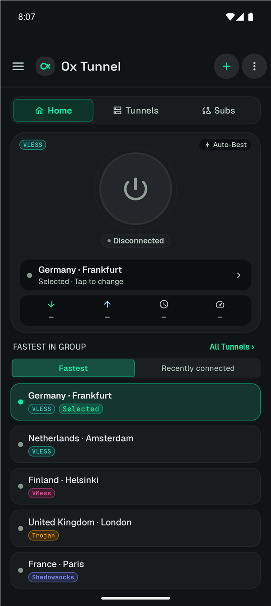
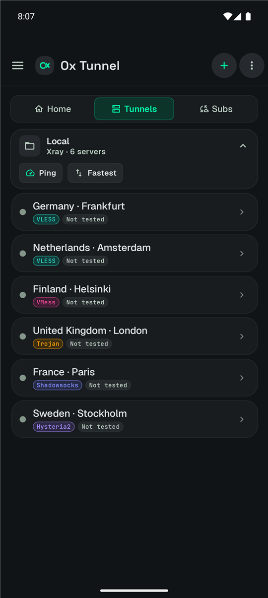
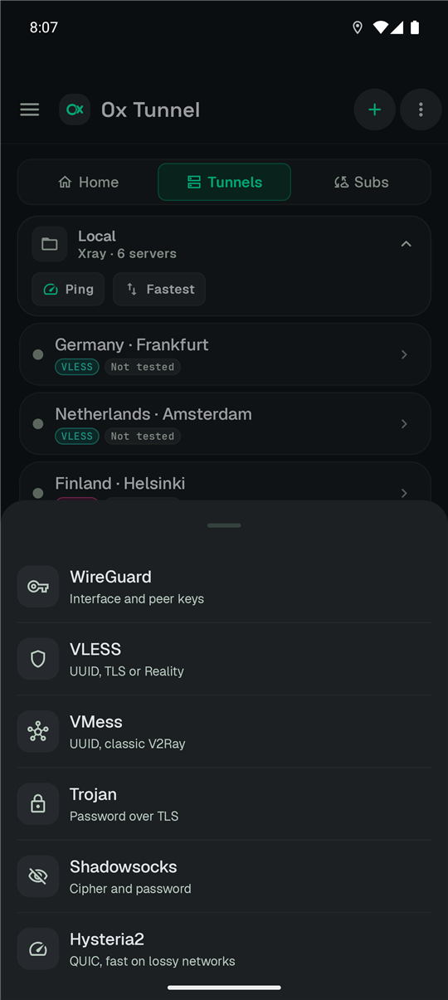
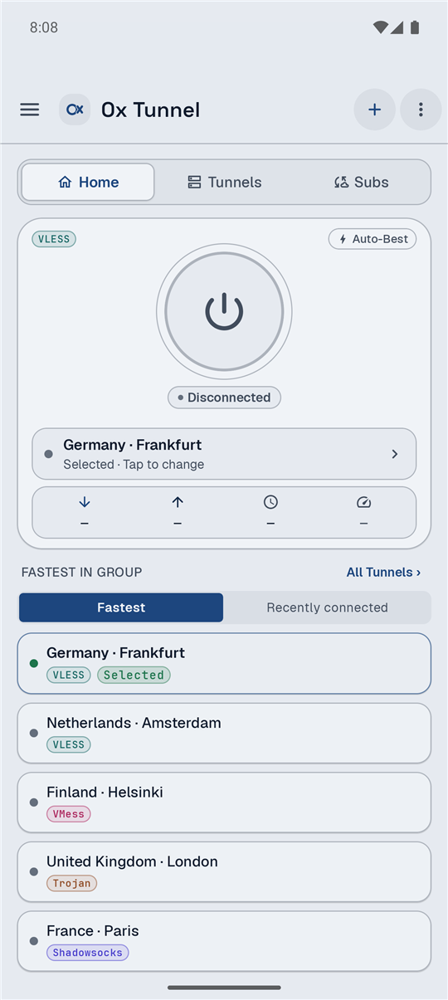
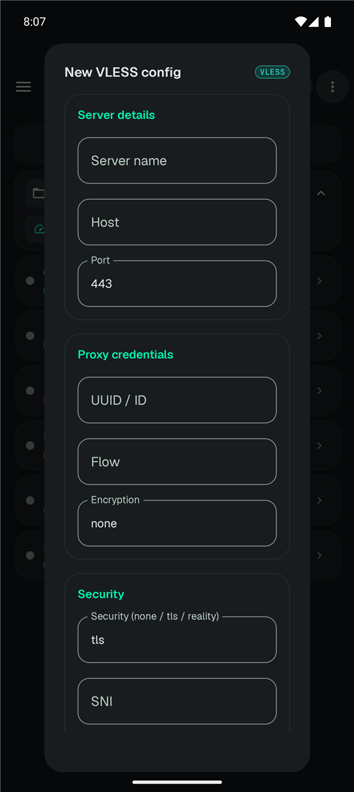
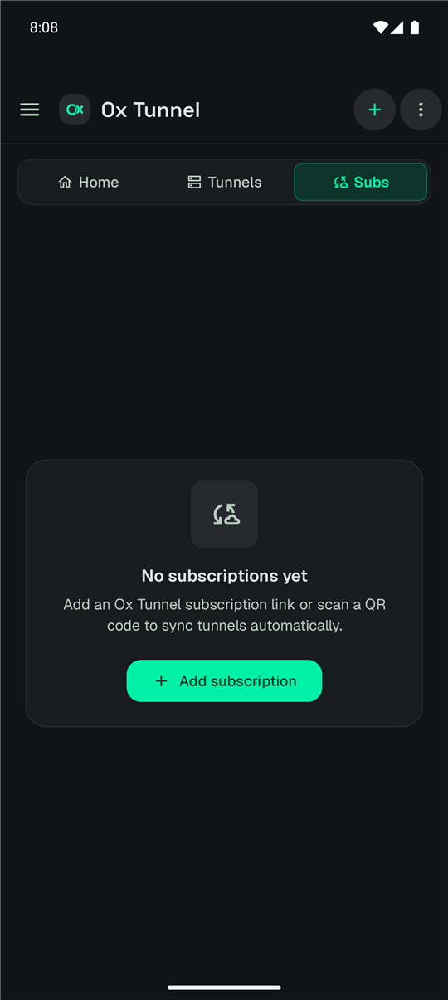
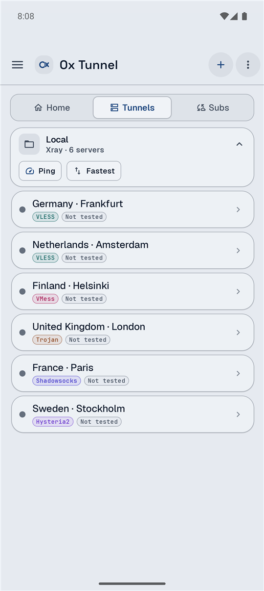

# Ox Tunnel

**WireGuard + Xray VPN client for Android**

[**Download the latest version**](https://github.com/MasterALiReza/OxTunnel/releases/latest)

[فارسی](#فارسی) · [English](#english)

   

---

## English

Ox Tunnel connects with WireGuard and with Xray protocols (VLESS, VMess, Trojan, Shadowsocks and Hysteria2), all in one app.

### Features

- **Many protocols**: WireGuard, VLESS (TLS / Reality), VMess, Trojan, Shadowsocks and Hysteria2.
- **Subscriptions**: add a subscription link and its servers update on their own. The app shows the data and time you have left, and tells you clearly when a plan has expired or its data is used up.
- **Auto-Best**: pings the servers and picks the fastest one for you.
- **Easy import**: QR code, clipboard, file, or a new config made from scratch, with a type picker.
- **Persian and English**, with full right-to-left support.
- **Dark and light themes**.

### Download

Open the [Releases](https://github.com/MasterALiReza/OxTunnel/releases) page and pick one file:

| File | For |
|---|---|
| `oxtunnel-standalone-v*-arm64.apk` | Most phones made in the last few years (recommended) |
| `oxtunnel-standalone-v*-armv7.apk` | Older 32-bit phones |
| `oxtunnel-standalone-v*.apk` | Universal: works on both, larger file |

Requires **Android 8.0** or newer. Each release lists SHA-256 checksums so you can check your download.

### Screenshots

| Home | Tunnels | New config |
|---|---|---|
|  |  |  |

| VLESS form | Subscriptions | Light theme |
|---|---|---|
|  |  |  |

### License and credits

The source code of Ox Tunnel is not public. This repository only hosts the release files. Ox Tunnel is built on open-source software; see [NOTICE.md](NOTICE.md).

---

## فارسی

Ox Tunnel یک برنامهٔ VPN برای اندروید است که هم با وایرگارد و هم با پروتکل‌های Xray (VLESS، VMess، Trojan، Shadowsocks و Hysteria2) کار می‌کند؛ همه در یک برنامه.

### امکانات

- **چند پروتکل**: وایرگارد، VLESS (با TLS یا Reality)، VMess، Trojan، Shadowsocks و Hysteria2.
- **سابسکریپشن**: لینک اشتراک را اضافه کنید تا سرورها خودکار به‌روز شوند. حجم و زمان باقی‌مانده نمایش داده می‌شود. وقتی اشتراک تمام شود یا حجمش به پایان برسد، برنامه این را واضح به شما می‌گوید.
- **Auto-Best**: سرورها را پینگ می‌کند و سریع‌ترین را برایتان انتخاب می‌کند.
- **افزودن آسان**: با کد QR، کلیپ‌بورد، فایل، یا ساختن کانفیگ جدید با انتخاب نوع آن.
- **فارسی و انگلیسی**، با پشتیبانی کامل راست‌به‌چپ.
- **تم تیره و روشن**.

### دانلود

به صفحهٔ [Releases](https://github.com/MasterALiReza/OxTunnel/releases) بروید و یکی از این فایل‌ها را بردارید:

| فایل | مناسب برای |
|---|---|
| `oxtunnel-standalone-v*-arm64.apk` | بیشتر گوشی‌های چند سال اخیر (پیشنهادی) |
| `oxtunnel-standalone-v*-armv7.apk` | گوشی‌های قدیمی ۳۲ بیتی |
| `oxtunnel-standalone-v*.apk` | نسخهٔ همگانی؛ روی هر دو نوع کار می‌کند ولی حجمش بیشتر است |

حداقل **اندروید ۸٫۰** لازم است. کنار هر نسخه، چک‌سام SHA-256 هم آمده تا بتوانید سالم بودن فایل دانلودشده را بررسی کنید.

### مجوز و قدردانی

سورس‌کد Ox Tunnel عمومی نیست و این مخزن فقط فایل‌های نصبی را منتشر می‌کند. Ox Tunnel بر پایهٔ نرم‌افزارهای متن‌باز ساخته شده است؛ جزئیات در [NOTICE.md](NOTICE.md).

