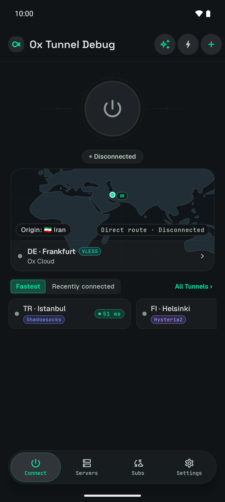
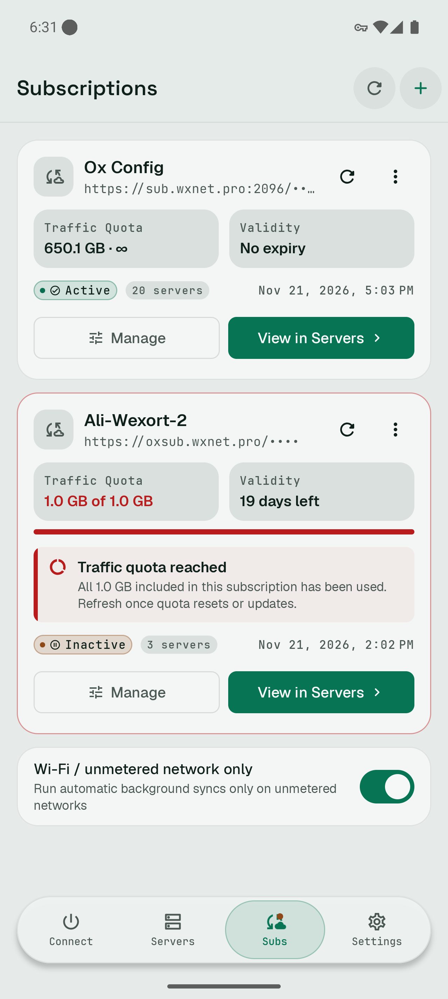
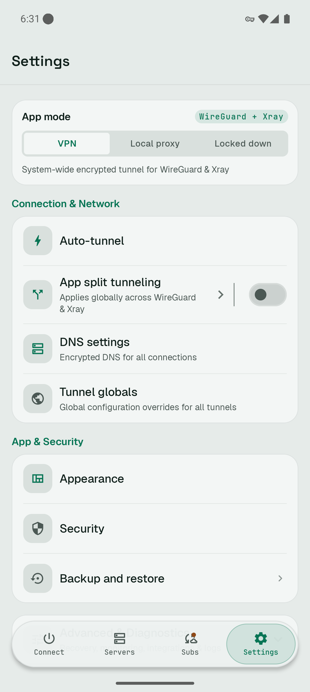

<div align="center">

# Ox Tunnel

VPN app for Android: WireGuard and V2Ray configs in one place.

[**Download**](https://github.com/MasterALiReza/OxTunnel/releases/latest) · [Telegram](https://t.me/OxVpN_Net)

   

</div>

<div dir="rtl">

## فارسی

یک اپ برای همهٔ کانفیگ‌ها: وایرگارد، VLESS، VMess، Trojan، Shadowsocks و Hysteria2.

- لینک سابسکریپشن را یک بار اضافه می‌کنید و سرورها خودشان به‌روز می‌شوند. حجم و روزهای باقی‌مانده هم همیشه جلوی چشمتان است.
- اگر سروری قطع شود، اپ خودش به یک سرور سالم دیگر وصل می‌شود.
- با یک دکمه سریع‌ترین سرور را پیدا کنید.
- می‌توانید انتخاب کنید کدام برنامه‌ها از VPN رد شوند.
- نسخهٔ جدید که بیاید، از داخل خود اپ آپدیت می‌شود.
- فارسی و انگلیسی، با تم تیره و روشن.

**دانلود:** از [Releases](https://github.com/MasterALiReza/OxTunnel/releases/latest) فایل `arm64` را بگیرید. برای گوشی‌های قدیمی `armv7` است، و اگر مطمئن نیستید فایل بدون پسوند را بگیرید. حداقل اندروید ۸ لازم است.

### افزودن اشتراک با یک کلیک از تلگرام

تلگرام در دکمه‌های ربات و پیام‌ها فقط پیوندهای `http(s)` و `tg` را قابل کلیک می‌کند. برای ساخت دکمه «افزودن به آکس تانل» از صفحهٔ پل HTTPS زیر استفاده کنید (توکن در `#` روی دستگاه کاربر می‌ماند و به سرور ارسال نمی‌شود):

```
https://masteralireza.github.io/OxTunnel/add#<url-encoded-https-subscription-url>
```

این صفحه اپ را با پیوند `oxtunnel://add?url=<url-encoded>` باز می‌کند و در صورت نصب نبودن اپ، دکمه دانلود آخرین نسخه را نشان می‌دهد. اپ پیش از ذخیره همیشه پنجره تأیید را به کاربر نمایش می‌دهد.

</div>

## English

One app for WireGuard, VLESS, VMess, Trojan, Shadowsocks and Hysteria2.

- Add a subscription link once and the servers stay up to date. Data and days left are always visible.
- If a server goes down, the app moves you to a working one.
- Find the fastest server with one tap.
- Choose which apps go through the VPN.
- Updates install from inside the app.
- Persian and English, dark and light themes.

**Download:** from [Releases](https://github.com/MasterALiReza/OxTunnel/releases/latest), take the `arm64` APK. Use `armv7` for old phones, or the plain one if you are not sure. Android 8.0 or newer.

Questions and bug reports: [Telegram](https://t.me/OxVpN_Net) or [Issues](https://github.com/MasterALiReza/OxTunnel/issues).

### One-tap Telegram subscription bridge

Telegram inline buttons only support `http(s)://` and `tg://` links. Providers and bots can link users directly through the privacy-preserving GitHub Pages bridge (the URL in `#` stays client-side and is never sent to GitHub):

```
https://masteralireza.github.io/OxTunnel/add#<url-encoded-https-subscription-url>
```

The bridge validates that the link uses `https://`, triggers `oxtunnel://add?url=<url-encoded>`, and offers a download button for the latest release if Ox Tunnel is not installed. Ox Tunnel always prompts for confirmation before adding the subscription.

The source code is private. Ox Tunnel uses open-source parts, listed in [NOTICE.md](NOTICE.md).
